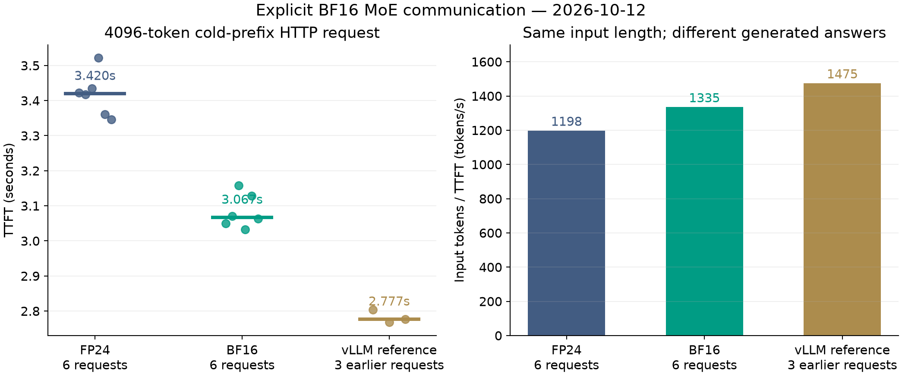

# BF16 跨卡通信：2026-10-12

> 后续已在停止后台 GPU 负载的条件下重新测量两种运行时，各六次：已安装 BF16
> **3.071 秒**、vLLM **2.771 秒**，TTFT 差 **10.84%**。新的重叠和实际 1024
> 分块候选均未保留，见[后续实测](prefill-optimization-20261012.md)。下方为 BF16
> 安装时的原始 FP24/BF16 结果。

已按用户选择安装显式配置 `mtp4-native-bf16-candidate`，MoE 的 prefill、decode、
MTP 和 Graph 通信都使用 **BF16 / 16 位**。两轮顺序相反的本机 HTTP 对比，
每版本六次完整 4K 请求：TTFT 中位数 **3.420→3.067 秒（−10.32%）**，
输入/TTFT **1197.70→1335.48 tok/s（+11.50%）**。

相对此前保留的 vLLM **2.777 秒**参考，仍相差 **290.36 ms / 10.46%**；
输入/TTFT 吞吐低 9.47%。vLLM 本轮没有重新测量，不能把这个差距当作
相同背景负载下的新一轮跨运行时对比。

## 实测结果

| 指标，中位数 | 保留 FP24 | 新 BF16 | vLLM 历史参考 |
|---|---:|---:|---:|
| 完整请求数 | 6 | 6 | 3 |
| TTFT ms | 3419.90 | 3067.07 | 2776.71 |
| 输入 / TTFT tok/s | 1197.70 | 1335.48 | 1475.13 |
| 输出 token | 457 | 409 | 494 / 512 / 333 |
| decode N−1 tok/s | 85.81 | 92.72 | 回答不同 |
| 完整请求 ms | 8737.35 | 7460.61 | 回答不同 |

FP24 六次 TTFT：3422.44、3417.35、3434.47、3521.72、3361.18、3346.38 ms。
BF16 六次：3049.41、3070.42、3157.67、3033.09、3127.82、3063.72 ms。
第一轮 FP24→BF16，中位数 3422.44→3070.42 ms；
第二轮 BF16→FP24，分别为 3063.72、3361.18 ms，两轮均改善。



BF16 改变了舍入边界，因此完整回答也改变了。每个版本自己的六次回答
完全一致，但两个版本不是同一回答；上表 decode 和完整请求耗时是观察值，
不能据此声称同一回答的 decode 提速或把总耗时缩短全部归因于执行优化。
BF16 的 409-token 哲学短文完整结束，原始 SSE 保留。

- FP24 文本 SHA256：`676c591a4cf676b89a230a53e41d9a7b09726348b0afcc67df602f52521b6e9c`。
- BF16 文本 SHA256：`9d24f298be3f0f3ebad6ceebefe1d7d8971854b4a489f0d0a30c5a994bca8cfc`。

计时边界是 Z4 本机 HTTP 请求开始到首个非空 SSE content，包含 tokenizer、
reset、prefill 和首 token；输入吞吐按 4096 / TTFT 计算，不是纯 GPU kernel
prefill 时间。固定 MTP4、chunk 512、原有 W4/W8 权重、RAM PLE 64 GiB、
每卡 200W、单请求、greedy、no-thinking。每组预热为一次 19-input/8-output，
再两次 4096-input/8-output；正式进程关闭完整 logits 诊断和 GPU profiling。

12 次 metadata 均 prefix=0、suffix=4096、cold_rebuild=true、terminal reuse=false。
请求区间内 major faults、swap-in/out、failures/rollbacks、Graph fallback、
CUDA allocation failure 都没有增量，process swap=0。

本轮原生测量期间两个 ComfyUI 容器仍运行，五个市场/Kafka 容器在此前重启后
保持停止；旧 vLLM 参考的背景不同。已有夜间挖矿启动任务在最后一组 FP24
期间触发，其停止 ComfyUI 的过程未由本轮发起。两个容器实际退出时间分别
为 16:31:40、16:33:10 UTC，均在全部性能请求结束后；miner 16:33:10 UTC
启动，性能测试 16:31:22 UTC 已结束，没有 GPU 挖矿重叠。
背景调度并未被完全控制，本表是小样本测量，没有长期吞吐或统计置信区间结论。

## 16 位的具体含义

新配置继承大块 P2P 配置，并仅增加 `Q38_TP_MOE_BF16_REDUCE=1`，没有选用
FP24/RSAG 舍入策略。每张卡先将本地 FP32 MoE partial RNE 到 BF16，再用
固定 rank0+rank1 顺序在 FP32 中相加，最后 RNE 到 BF16。
这与旧配置“先合并原始 FP32 partial，再舍入”不同。

`te_bridge_allreduce_f32_as_bf16` 保留输入 FP32 buffer，使用独立 BF16 输出。
它支持 host-bounce、同步/异步 P2P，以及记录的 Graph collective；小批量的
shared-expert 分支继续并行执行并在消费前汇合。所有 token 数均应用同一
通信策略，包含 decode 和 MTP，而不只是大块 prefill。

对大块 eager P2P，双向主要 DMA payload 从 FP24 的约 5N 字节及 metadata
降到 4N 字节，约减少 20%，也无需不确定边界的原始 FP32 回读。这是逻辑
payload 分析，不是 PCIe 总事务字节实测。新 BF16 collective 的计数沿用
BF16 逻辑 extent，不应当作实测链路流量。

独立 fixture 的 512×2560 五次中位数：FP24 **2497.74→BF16 1932.36 μs**
（−22.64%）；两个 group 同时执行 **4903.43→3861.38 μs**（−21.25%）。
安装后重新编译并运行同一 fixture 通过；收益不代替整模型测量。
上次未完成验收的 bulk MoE direct-reduction 改动没有合入；Marlin 两个相关
源码与原正式版本 SHA256 一致。

## 正确性证据及数值限制

完整核验 **354 segments / 212,367,104,472 字节**，新 session hash
`15997379919937726889`。编译在模型停止时完成，模型加载没有与编译重叠。

- 通信 fixture 与“先逐 rank 舍入，再 BF16 求和”的独立 scalar 路径逐位一致。
  覆盖随机 FP32、舍入边界、NaN/Inf、signed zero、subnormal、非对齐/奇数
  extent、65536 边界、双 group、交替 stream、scratch 增长、延迟 producer、
  输入不变、输出立即覆盖和非法 extent/重叠拒绝。
- Graph 覆盖五种 transport、两个 group、128 次改变输入及 32 次排队启动，
  包含独立分支汇合、capture failure、mismatch/reset；C++ runtime/rank worker
  与 Z4 106 项 Python 检查通过。Mac 安装后 `make test` 通过，106 项 Python
  中一项可选 tokenizer fixture 缺依赖跳过。
- 两次独立 BF16 模型加载：5 类输入、10 个强制拒绝位置的 MTP token 和
  每个场景三次完整 248320-vocab BF16 tail logits 完全一致。
- 同一 BF16 配置下，5 类输入（含 8192 context）的 MTP 与逐 token 执行
  token、三步 committed continuation 一致；10 个拒绝位置的发布长度、
  token、后续 continuation 也一致。
- 9 项完整数学/JSON/Unicode/代码质量检查通过；3 类 raw cancellation、
  deadline/reset 的完整 BF16 恢复一致；HTTP cancel/recovery/disconnect
  recovery 通过。

**没有通过、也不声称 MTP 与逐 token 执行的完整 logits 逐位一致。**
首次 BF16 检查在数学题发现 token 相同、logits 不同，因此停止验收并保留
失败证据。对保留 FP24 二进制的新审计表明：全部 5 类输入和 10 个拒绝位置
也都有同样的完整 logits 不一致，token 仍相同。这是已有批量 target 执行
的数值限制；新 BF16 检查改为严格的同路径重复全 logits 一致性，逐 token
对照仍要求 token/continuation 一致。

两种精度各 45 个完整快照均有限值；最差差异都在 long8192 第三次 tail：
FP24 的最大绝对差 1.4661、relative L2 0.1217；BF16 为 1.8438、0.1665。
BF16 没有消除该问题，这些有限样例不证明所有输入的 MTP/逐 token 数值或
token 等价，也不证明与 vLLM 输出等价或最终模型质量。保留为显式研究候选。

## 安装、启动和回退

Mac/Z4 九个改动源码 SHA256 一致，九个旧 profile 保持原内容，并继续清理
ambient Q38 开关。正式 BF16 路径：
`/home/icy/Homelab/Qwen3.8-Flash-Next-Dual-GPU/build/native-bf16/q38-cuda-runtime`。

SHA256：`ae51b96eb0e1122d069bfa7e8c4add722df5e024c2031a05b0620e7b00b8748e`。

在 Z4 使用下面的显式入口；本轮没有启动常驻推理服务：

```bash
cd /home/icy/Homelab/Qwen3.8-Flash-Next-Dual-GPU
LD_LIBRARY_PATH=/usr/local/cuda-13.3/lib64 .venv/bin/python tools/q38_tp_launch.py \
  --ready /home/icy/models/Qwen3.8-Flash-Next-q38-cut25/READY.json \
  --tp-root /home/icy/q38-native-target160-20261004/gdn-qkvz-artifact \
  --runtime build/native-bf16/q38-cuda-runtime \
  --execution-profile mtp4-native-bf16-candidate \
  --ple-storage ram --ple-ram-budget-gib 64 --segment-hash-workers 2 \
  --state-dir /home/icy/q38-native-bf16-serving --port 30001
```

回退使用保留的 `build/native-prefill-fp24/q38-cuda-runtime`、
`mtp4-native-prefill-fp24-candidate` 和独立 state 目录。
FP24 SHA256 仍为
`73269e71cd9edc3305f36adf9a1acc94860c0a54d76d27ea5055e7d12b0f5be9`。
改动前源码备份位于实验目录 `installed-backup/mac` 和 `installed-backup/z4`。

Mac 落盘 1274 个实时样本，全程同一 boot，无捕获到的 Xid/OOM/AER/panic，
OOM kill 无增长、swap-in=0。整个观测窗口 swap-out 164 pages，正式性能
请求内没有增长；最小 MemAvailable 190.65 GiB。此前整机重启原因仍未解决，
本轮成功不构成长期稳定性结论。

结束时所有本轮 runtime、sidecar、编译器和观测进程已退出，27B 保持停止，
NAS `/mnt/nas` 保持只读。用户随后要求暂停挖矿，已向属于 icy 的 miner
主进程发送 SIGTERM；`pearl-miner.service` inactive/dead、Result=success，
两张 GPU 没有计算进程。原夜间 timer 保留，下一次计划为 10 月 13 日
00:30（上海时间）；未启动其他模型或恢复 ComfyUI 容器。

## 原始证据

Mac：`build/bf16-transport-20261011/`；Z4：`/home/icy/q38-bf16-transport-20261011/`。
目录日期是实验开始日期，本文按上海时间的完成日期命名。

- `summary.json`、`benchmark-live.log`、四个 performance phase 的请求/SSE/stats。
- `qualification/qualified.json`、`full/`、`first-canonical-exact-failed/`、
  `canonical-audit-fp24/full/`，以及 `numerical-summary.json`。
- `review.patch`、source hashes、profile audit、`marlin-unchanged.json`。
- `build-tests.log`、`primitive-final.log`、`installed-primitive.log`、
  `mac-installed-test.log`、`installed-{mac,z4}.json`。
- `incident/` 的外部 fsync 记录及摘要、挖矿前后状态记录。

vLLM 参考及逐层耗时分布来自[此前报告](prefill-distribution-20261011.md)；
精确 FP24 的历史记录见[原报告](prefill-exact-transport-20261011.md)。
