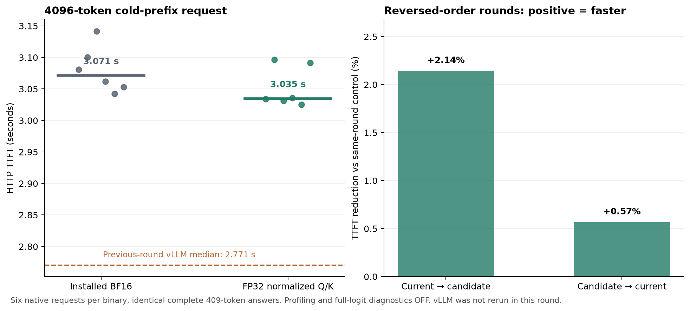

# GDN FP32 规范化 Q/K 缓存：2026-10-12

已安装显式配置 `mtp4-native-bf16-gdn-qk-candidate`。冻结真实文本 4096-token
请求、两轮反向 A/B、每版本六次：HTTP TTFT 中位数 **3071.27→3034.81 ms**，
缩短 **36.46 ms / 1.19%**；输入/TTFT **1333.66→1349.67 tok/s（+1.20%）**。
两个顺序均改善，全部完整 409-token 回答保持一致。

改善幅度较小，样本范围重叠，不代表统计置信度或所有负载都提速。
相对[上一轮重新测得的 vLLM](prefill-optimization-20261012.md) **2770.79 ms**
参考，新候选仍慢 **264.02 ms / 9.53%**。本轮没有重测 vLLM，不能把这个
参考差距当作新一轮同步跨运行时测量。



## 实际 HTTP 测量

| 中位数 | 原 BF16 | 新 GDN Q/K 缓存 |
|---|---:|---:|
| 正式请求数 | 6 | 6 |
| TTFT ms | 3071.27 | 3034.81 |
| 输入 / TTFT tok/s | 1333.66 | 1349.67 |
| decode N−1 tok/s，同一回答 | 92.90 | 92.86 |
| 输出 token | 409 | 409 |

第一轮原版→候选：3100.23→3033.79 ms，改善 2.14%。
第二轮候选→原版：原版 3053.13、候选 3035.83 ms，改善 0.57%。

原版六次：3080.57、3100.23、3141.70、3061.96、3042.19、3053.13 ms。
候选六次：3033.79、3096.17、3031.42、3035.83、3025.07、3091.67 ms。

安装后的额外独立对照，各三次：原 BF16 **3087.09 ms**，已安装候选
**3037.01 ms**，缩短 **50.09 ms / 1.62%**；六次仍为相同的完整 409-token
回答。原版三次 3043.80、3211.96、3087.09 ms；已安装候选三次
3044.31、3037.01、2991.84 ms。该对照单独保存，未混入上方主 A/B 的六次
中位数；它同样不能提供统计置信度。

每次从 Z4 本机 HTTP 请求开始计时，到第一个非空 SSE content；包含 tokenizer、
reset、prefill 和首 token，不是纯 kernel prefill。各次模型加载后统一预热一次
短输入 / 8 输出，再两次 4K / 8 输出；加载、JIT 不计入 TTFT。
性能进程关闭 GPU profiling 与完整 logits 诊断。原版使用实际保留的已安装
`build/native-bf16/q38-cuda-runtime`，候选使用新的独立二进制，所有其他
profile options 保持一致：MTP4、chunk 512、RAM PLE 64 GiB、P2P、原有 W4/W8、
greedy、no-thinking、每卡 200W、单请求。

十二次完整文本 SHA256 均为
`9d24f298be3f0f3ebad6ceebefe1d7d8971854b4a489f0d0a30c5a994bca8cfc`。
所有 metadata 为 prefix=0、suffix=4096、cold_rebuild=true、terminal reuse=false。
每个请求区间 major faults、swap-in/out、failure/rollback、Graph fallback、CUDA
allocation failure 均无增长。Decode 基本不变，没有据此声称 decode 提速。

## 实现和内存

原 GDN 在递推循环中重复加载 BF16 Q/K、转换为 FP32，再乘已计算的 norm scale。
每个 query/key head 的多个 value head 和 state-column tile 都重复这项计算。
新配置在原有 prepare kernel 中计算规范化 Q/K，存入单独的 FP32 临时缓冲区，
递推直接加载这些已舍入的 FP32 值。

FP32 norm、decay、beta、四个 resident state cell，以及固定的 row 0..31
累加顺序保持原样；BF16 convolution/core/output 边界、原投影 GEMM 形状、
W4/W8 权重、MoE 的 16-bit BF16 通信均不变。没有改成并行 chunk GDN。
缓存只在非 decode 且 tokens≥8 的 head-local prefill 使用；decode / 小 MTP
保持原实现。旧的 global GDN reference 仍可用。

开关为 `Q38_CUDA_GDN_PREFILL_NORMALIZED_QK=1`。每个逻辑 stage/rank 预分配
8 MiB：两个 FP32 数组、512 token × 16 canonical key heads × 128 elements。
同一 GPU 上有两个逻辑 stage，增加约 **16 MiB / GPU**；只有 owned heads
写入和使用，缓存不属于 committed/prefix state。后续 slab 在同一 stream
顺序复用，没有 steady-state 分配。新 profile 只增加这一开关；十个旧 profile
内容保持不变，并继续清理 ambient Q38 flags。

## 验证与诊断边界

通用 CUDA kernel tests、C++ runtime/rank-worker 回归通过。Z4 使用完整 venv
运行 107 项 Python 检查，全部通过、无跳过；Mac 安装后的 `make test` 通过，
107 项中一个可选 tokenizer fixture 因缺依赖跳过。

head-local fixture 覆盖两个逻辑 rank、四种投影布局、decode 和 1/5/8/15/127/
512/513-token prefill；64 组案例均检查 eager / Graph 的完整输出、owned
convolution/recurrent state 和前缀快照逐位一致。另检查缺少 FP32 缓存必须
在提交 kernel 前拒绝、缓存首尾 guard 与 unowned heads 不被写入。安装后的
同一 GPU fixture 独立重跑通过。

算子计时把 D2D state reset 放在 event 区间外，20 次取中位数；包含
convolution、prepare、recurrent、norm 和 fixture 的少量 prefix 写入，不是
纯 recurrent kernel。固定 16-column：rank0 约 1468→1232 µs，rank1
约 1461→1234 µs，改善约 15–16%。32-column 变体更慢，因此 profile 仍保留
原来的 16-column 设置，没有据算子结果改其他配置。

整模型新二进制通过 9 组完整质量回答、5 个输入案例和 10 个强制拒绝位置，
共 45 份完整 248320-vocab BF16 logits、token 和续写逐位匹配旧 BF16
**同执行路径**参考；raw cancel/deadline 与 HTTP cancel/disconnect/recovery
各三项通过。

保留的 FP24 / BF16 都存在 scalar / MTP 完整 logits 不逐位一致的问题，
见[BF16 数值限制](bf16-transport-20261012.md)。本轮没有消除该问题，也不声称
通用 scalar/MTP token 等价、vLLM 输出一致或最终模型质量。

另一次 globaltimer scopes 确认仍为八个 512-token slab、每 GPU 288 个 GDN
recurrent/norm 窗口。同类诊断 GPU0 的 union 约 387.42→328.36 ms，GPU1
391.23→335.14 ms；但诊断总范围 3289.73 ms，与旧 512 诊断 3227.09 ms
相反。窗口包含 CPU 提交、排队与等待，逻辑 stage 和 category 会重叠；两次
不是同一二进制的反向 A/B，不能相加或相减作为关键路径预算。正式收益只用
上面的诊断关闭 HTTP 对照。本轮没有使用 CUPTI。

权重复用此前完整校验的 354 segments / 212367104472 bytes、session
15997379919937726889：同一 boot，NAS artifact 保持只读、未修改；新二进制
独立完成质量与恢复验收。本轮没有重新完整哈希所有权重。

## 安装、启动与回退

Mac / Z4 七个修改源码 SHA 一致，新二进制固定为：
`/home/icy/Homelab/Qwen3.8-Flash-Next-Dual-GPU/build/native-bf16-gdn-qk/q38-cuda-runtime`。
SHA256 为 `e2c6ab92c84d5155e08abf7ce65345353b24fb45a97071577684d7c136f12063`。
源码备份在本轮 `installed-backup/mac` 和 `installed-backup/z4`。原 BF16
`build/native-bf16/q38-cuda-runtime` 的 SHA
`ae51b96eb0e1122d069bfa7e8c4add722df5e024c2031a05b0620e7b00b8748e` 保持不变，
FP24 二进制也保留。

Z4 显式启动命令，创建独立 state 目录：

```bash
cd /home/icy/Homelab/Qwen3.8-Flash-Next-Dual-GPU
LD_LIBRARY_PATH=/usr/local/cuda-13.3/lib64 .venv/bin/python tools/q38_tp_launch.py \
  --ready /home/icy/models/Qwen3.8-Flash-Next-q38-cut25/READY.json \
  --tp-root /mnt/nas/ai/models/z4-offload-20261009-native/gdn-qkvz-artifact \
  --runtime build/native-bf16-gdn-qk/q38-cuda-runtime \
  --execution-profile mtp4-native-bf16-gdn-qk-candidate \
  --ple-storage ram --ple-ram-budget-gib 64 --segment-hash-workers 2 \
  --state-dir /home/icy/q38-native-bf16-gdn-qk-serving --port 30001
```

回退使用 `build/native-bf16/q38-cuda-runtime` 与
`mtp4-native-bf16-candidate`，并使用独立旧 BF16 state 目录。新 flag 在旧
profile 中会被清理，避免环境残留导致意外启用。
没有修改默认选择、自动启动、硬件、驱动或夜间定时器。

## 证据

Mac：`build/gdn-normalized-prefill-20261012`；Z4：
`/home/icy/q38-gdn-normalized-prefill-20261012`。编译和安装回归在模型停止时运行；
初次验收脚本因新 qualification 目录不存在而退出，模型未启动，日志保留，
修正目录创建后才开始有效验收。

804 次外部 fsync 采样保持 boot `c354ceb6-2af6-4725-845f-aa7b20afc984`；没有
捕获 Xid、OOM、AER/fatal 或 panic，swap-in=0、swap-out 始终为原有 164 页，
最低 MemAvailable 191.73 GiB。此前整机重启原因仍未解决，这些有限测试不能
证明长期稳定性。

结束时本轮模型、sidecar、编译器和采集进程均退出，没有启动常驻原生推理服务。
早晨定时任务已在测试前恢复两个 ComfyUI，当时没有 GPU 工作；测试期间暂停，
结束后恢复 `comfyui-h3`、`comfyui-qwen-image21`。27B 与 `pearl-miner.service`
保持停止，NAS `/mnt/nas` 保持只读，每 GPU 仍为 200W。夜间 timer 保留，
下一次挖矿启动为 2026-10-13 00:30 上海时间。

- `complete-source-audit.json`、`source-hashes.json`、`review.patch`、`profile-audit.json`：完整变更、旧 profile 和二进制证明。
- `build-tests.log`、`guard-tests.log`、`runtime-build-tests.log`、`python-tests.log`：CUDA、CPU 和缓存边界检查。
- `qualification/gdn-qk-full`、`gdn-qk-qualified.json`：完整质量、45 份 logits 和恢复验收。
- `qualification/{current-first,gdn-qk-first,gdn-qk-second,current-second}`、`summary.json`、`analyze.py`：正式反向 A/B、策略、原始 SSE 和 stats。
- `microbenchmark.json`、`timeline-summary.json`、`qualification/gdn-qk-timeline`：不含 reset 的算子计时及不可相加的诊断窗口。
- `installation.json`、`installed-gdn-test.log`、`installed-python-test.log`、`mac-installed-test.log`：安装与安装后回归。
- `qualification/{confirm-current,confirm-installed}`、`confirm-installed-live.log`：额外部署确认对照。
- `incident/telemetry.jsonl`、`incident/kernel-live.log`：Mac 外部 fsync 采集。
- `incident/summary.json`、`final-state.json`：采集汇总、安装后源码/二进制与服务状态。
