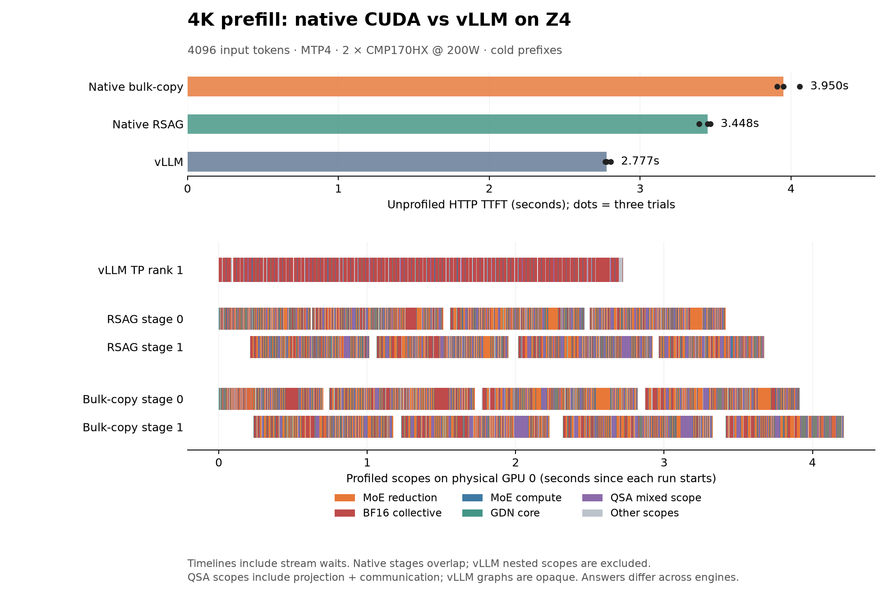

# Z4 prefill 耗时分布与无损 MoE 通信优化

2026-10-11。双 CMP170HX、SM80、每卡 200W、固定 MTP4、RAM PLE。
NAS 已规范为 `/mnt/nas`，兼容迁移见 [NAS 整改](nas-path-20261011.md)。
`huihui-w4-vision-video`（27B）全程保持停止，所有测试模型最终停止。

## 真实请求结果

同一冻结 4096-token messages，greedy/no-thinking，Z4 本机标准 SSE 客户端，
计时到第一个非空 content。每版预热一次短请求和两次 4K，再独立测三轮。
下表是未开启 GPU 采样的中位数，不扣 RTT，不与上一批 llm_speedtest 的
RTT 修正值混用。权重校验、NAS 读取、模型加载均不计入 TTFT。

| 指标 | 原生 bulk-copy | 原生 RSAG 候选 | vLLM 适配版 |
|---|---:|---:|---:|
| 实际输入 token | 4096 | 4096 | 4096 |
| 实际输出 token | 457，每轮一致 | 457，每轮一致 | 494 / 512 / 333 |
| TTFT ms | 3950.35 | **3447.86** | 2776.71 |
| 输入 / TTFT，tok/s | 1036.87 | **1187.98** | 1475.13 |
| Decode N−1 tok/s | 85.61 | 85.81 | 回答不同，不作为等长对照 |
| 端到端 ms | 9279.92 | 8760.79 | 回答不同 |

原生 prefill 指标改善 **14.57%**，TTFT 降低 **12.72%**。
仍未追平 vLLM：候选 TTFT 比本轮 vLLM 高 24.17%。
两版原生六次完整回答相同，SHA256
`676c591a4cf676b89a230a53e41d9a7b09726348b0afcc67df602f52521b6e9c`。
原生 SSE metadata 全部 prefix=0、suffix=4096、cold rebuild，未复用 terminal
prefix；vLLM 每次使用唯一 cache_salt，prefix hit=0。因此本轮差距不能归于
一方命中了 KV/prefix cache。两版原生三轮期间 major fault 增量分别为
0 / 0，
process swap=0，系统 swap-in/out 无增量。

vLLM 在三轮相同 greedy 请求下输出长度和 SHA256 仍会变化，未证明跨运行时
数值或完整回答一致。以上比较的是相同输入和首内容边界，不是等长 decode。
其另一次 CPU-trace 克隆三轮 TTFT 中位数 2803.76 ms，也支持当前约 2.8s 的
参考水平。原生草稿接受率为
33.46% /
33.46%，宽度均为 4。

短网页 16 输入 / 1024 输出的原有 N decode 指标为
178.38→177.43
tok/s，两版均与此前 qualified 文本完全一致。

## GPU 耗时分布



CMP 上 Torch/CUPTI 明确返回 `CUPTI_ERROR_CMP_DEVICE_NOT_SUPPORTED (42)`。
第一次 Torch trace 只有 CPU 活动，不能作为 kernel 时间。原生 Nsight
late-start 另触发了一次 libcupti 用户态 segfault；该报告没有 CUDA kernel 表，
不纳入 GPU 分布。没有据此改变驱动或重启机器。

实际采用两种独立诊断：vLLM `/start_profile` 临时安装 CUDA event hook，
`/stop_profile` 恢复，关闭 CUPTI GPU 采样；原生用已有 GPU globaltimer marker，
新增可选 JSON 绝对区间。正式延迟请求未开启这些 hook/marker。
原生绝对时间线另用独立 constructor overlay，使 prefill profile 选择
external globaltimer marker。该诊断二进制 SHA256
`f280b73593d5c2106c3f8ca3cfaa2d6f36bb989b7cde56107a8a272f9665a096`，没有安装；已合格的正式二进制与
三轮 HTTP 测量保持不变。诊断 state 只校验 index/extents，权重完整 hash
使用本轮正式候选之前的 354-segment 校验，未将诊断 manifest 标为 full hash。
最初仅有相对 CUDA event 的采样保留在 `timeline-*-cuda-event-only/`，
不用于区间合并。补采对每版验证 32 条 512-token 绝对时间记录，并核对
预热与首 token 文本一致。

vLLM 每个 rank 得到 1515 个 scope，保留 parent、stream、shape、dtype，汇总只
取 root scope，避免把 MoE/GDN 与其内部 kernel 相加。Native 每卡合并两个
并行 stage 的区间，不能把两个 stage 或两个 GPU 的毫秒数相加当作 TTFT。

以下都是物理 GPU 0 的独立运行，按各自时钟归一化。vLLM rank 1 对应该卡。
“通信”只统计已明确识别的 collective scope；原生 QSA output 包含 GEMM 和
通信，放在其他窗口，vLLM 小块 Graph 为 opaque。两者范围不同，因此表格
不是逐 kernel 的同口径硬件归因。

| 独立采样 | GPU 区间跨度 ms | 仅通信窗口 ms | 仅其他窗口 ms | 两类重叠 ms | 未覆盖 ms |
|---|---:|---:|---:|---:|---:|
| vLLM TP rank 1 | 2726.0 | 2230.1 | 454.4 | 0.0 | 41.5 |
| 原生 bulk-copy | 4211.5 | 1668.3 | 890.1 | 1646.4 | 6.7 |
| 原生 RSAG | 3675.0 | 1196.3 | 837.9 | 1633.9 | 6.8 |

原生同类别窗口跨 stage 取 union，非可相加的请求预算：

| GPU 0 类别 union ms | bulk-copy | RSAG |
|---|---:|---:|
| MoE 归约窗口 | 2370.5 | 1999.6 |
| GDN collective | 1565.1 | 1228.7 |
| GDN recurrent + norm | 386.9 | 393.7 |
| MoE Marlin | 464.4 | 471.3 |
| QSA output，混合投影/通信 | 712.5 | 580.6 |

vLLM 的 101 次 `vllm::all_reduce` 输入全部是 BF16，其中 100 次
4088×2560（20,930,560 字节）和一次 8×2560；rank 1 累计窗口
2159.7 ms。
另有 6 次 all-gather，union
70.4 ms。
这些 CUDA event 区间包含 stream 等待和 CPU enqueue 间隙，不能声称都是
纯 PCIe copy/kernel 时间。通信仍是两个实现都需重点处理的成本。

原生是 TP2、两个逻辑 stage 共享两张卡、512×8 分块；vLLM 是 TP2/EP、PP1，
本次 execute 注解为 4088+8。GDN scope 的明显差距需要结合批量布局和
算法分析。已核对容器与本地 vLLM GDN 源码 SHA256 一致，其 prefill 调用
`chunk_gated_delta_rule`；原生仍有逐 token recurrent 执行。下一项应针对
GDN 和剩余 BF16 attention collective 继续优化并重新做数值门禁，不能把
不同加法次序当成已验证的无损替换。

## 保留的优化

新 eager P2P 算子先分半交换 FP32 输入，在各卡按 rank0+rank1 顺序计算
各自半块，执行一次 BF16 RNE，再交换 BF16 结果。每卡输入/输出传输量从
4n 字节变为 3n，MoE collective 总量降低 25%；未提前把局部 FP32 结果
舍入。两个 producer-ready、reduce-done、output-done 事件保护读写生命周期，
后续两卡均等待 peer gather 完成，scratch 增长/reset 仍 drain。

显式 profile `mtp4-native-prefill-rsag-candidate` 仅在已合格的 bulk-copy
profile 上添加 `Q38_TP_F32_BF16_RSAG=1`。仅 tokens≥8、eager P2P 且非 Graph
recording 时使用；小块 decode/MTP 和原有 Graph collective 继续使用旧算子。
旧 profile 清理 ambient Q38 环境，不会隐式启用新开关。

双卡 primitive 五轮测试中，512×2560 的 FP32 all-reduce + BF16 round
约 3.84→2.88 ms，两个 stage group 同时执行约 7.67→5.7 ms。
整模型收益使用上面的真实 HTTP A/B 单独验证，没有由 primitive 比例推算。

## 门禁、安装与证据

- 同步/异步、双 group、NaN/Inf/subnormal/signed-zero/RNE ties、非对齐地址、
  奇数尾部、延迟 producer、跨 stream 排队、scratch 增长、小大 payload
  混用及输出立即覆盖的逐位 fixture 通过；旧 bulk-copy/TE fixture 通过。
- 105 项 Python 检查通过；完整 CUDA runtime 构建成功。
- 安装后 Z4 正式 Makefile 的 `rsag-test CUDA_COMPAT=0` 通过；Mac C++
  runtime/rank-worker 与 105 项 Python 检查通过，1 项 optional tokenizer
  fixture 缺依赖跳过。
- 五类整模型输入含 8192 context、248320 维 BF16 logits、十个强制拒绝
  前缀、九个完整质量回答、三类 raw cancellation/deadline/reset 均与旧
  qualified oracle 一致；真实 API cancel、恢复及 disconnect 恢复通过。
- 候选三轮测量沿用通过门禁的进程，启用了 `--enable-logit-diagnostics`。
  2026-10-11 后续复核更正：该开关既允许 RPC 读取快照，也设置
  `retain_last_logits_for_diagnostics`，会保留完整尾部 logits；此前“仅控制
  RPC 权限”的描述不准确。测量窗口未发 logits 查询，未开启 event profiling。
  上表保留原始实测，候选与 baseline 的诊断设置不同；后续精确传输实验
  使用诊断关闭、profiling 关闭的同配置 A/B 单独计时。
- 原生测量期间 failures/rollbacks/Graph fallback/CUDA allocation failure
  无增量；完整 segment hash 校验 354 个文件，
  212,367,104,472 字节通过。历史整机重启原因仍未确定。

第一次把 raw 门禁与 HTTP 测量合并时，验收后的非空会话导致 sidecar 第一条
请求返回 409。脚本已在启动 sidecar 前显式 reset，并重新运行整轮门禁和
测量；失败记录保留在 `full-before-sidecar-reset-failed/`，未计入性能表。
vLLM 曾遇到 NAS source binding 与 PLE CUDA IPC 注册启动失败，均单独保存
日志。成功克隆带有启动期 PLE 注册诊断 overlay；这不是已经证明的通用
IPC 修复，不应据此修改正式 PLE 配置。

新二进制：Z4 正式源码目录 `build/native-prefill-rsag/q38-cuda-runtime`，SHA256
`6fc0881c40793532d97ecaccd3592cec9edd259220ffdee6162b2909385723eb`。旧 `build/native-prefill/q38-cuda-runtime` 和
旧 bulk-copy profile 保留，未启用常驻服务、未启动 27B。

```bash
cd /home/icy/Homelab/Qwen3.8-Flash-Next-Dual-GPU
LD_LIBRARY_PATH=/usr/local/cuda-13.3/lib64 .venv/bin/python tools/q38_tp_launch.py \
  --ready /home/icy/models/Qwen3.8-Flash-Next-q38-cut25/READY.json \
  --tp-root /home/icy/q38-native-target160-20261004/gdn-qkvz-artifact \
  --runtime build/native-prefill-rsag/q38-cuda-runtime \
  --execution-profile mtp4-native-prefill-rsag-candidate \
  --ple-storage ram --ple-ram-budget-gib 64 --segment-hash-workers 2 \
  --state-dir /home/icy/q38-native-rsag-serving --port 30001
```

回退用 `build/native-prefill/q38-cuda-runtime`、
`mtp4-native-prefill-candidate` 和新的 state 目录。

本地证据 `build/prefill-distribution-20261011/`：`native-qualification/`
保存质量、HTTP、取消恢复及原生时间线；`vllm-event-results/` 保存原始请求
和 SSE；`vllm-event-traces/` 保存 CUDA events 与 CPU trace；
`distribution-summary.json`、`analyze-distribution.py` 与导出 PNG/SVG 保存
区间合并和绘图；`rsag-installation.json` 保存安装 hash/备份记录；
`incident/` 保存实时落盘的 boot/GPU/memory/kernel 观测。
服务器同名实验目录 `/home/icy/q38-prefill-distribution-20261011/`。

最终观测记录 3706 条，boot ID 全程相同，无新 GPU Xid/OOM/AER。
整个观测窗口系统 swap-in=0，swap-out=15905 页；正式六轮请求的 swap-in/out
均无增量，不能把整个加载/采样窗口宣称为无 swap-out。唯一用户态 fault
是前述 Nsight/CUPTI segfault，失败 trace 保留。最终两卡各 306 MiB，200W
保持；全部自有模型、sidecar、采样容器及采集器停止，原有两个 ComfyUI 和
market/Kafka 容器继续运行。
