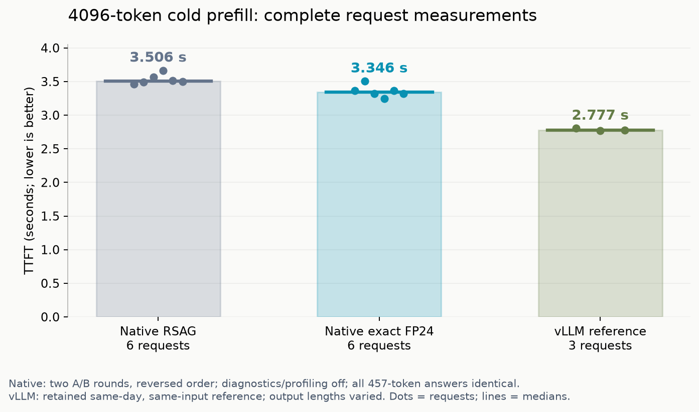

# 精确 FP24 通信与 Prefill 分块复测：2026-10-11

> 2026-10-12 已按用户选择增加独立 BF16 通信配置，FP24 保留供回退。新的六次配对结果、数值限制和启动说明见 [BF16 报告](bf16-transport-20261012.md)；本文仍记录原 FP24 实验。

> 后续 MoE 候选测试发生整机重启，新候选未采用。本文性能记录是此前已完成的测试；长期稳定性问题仍未解决。见[后续故障证据](moe-prefill-incident-20261011.md)。


已安装显式候选 `mtp4-native-prefill-fp24-candidate`。两轮顺序相反的
4K HTTP A/B、每版本 6 次请求中位数：TTFT **3.506→3.346 秒**，
输入/TTFT 吞吐 **1168.38→1224.14 tok/s（+4.77%）**。
12 次都是 4096 输入、457 输出，完整文本逐位一致。

今天此前同一输入的 vLLM 参考 TTFT 为 **2.777 秒**；当前仍相差
**0.569 秒 / 20.51%**。
vLLM 本轮未重新启动，沿用此前三次原始记录；其输出长度不同，本文不提供
跨运行时相同回答的 decode 比较。

## 同配置计时与收益

| 指标，中位数 | 旧 RSAG | 精确 FP24 候选 | vLLM 同日参考 |
|---|---:|---:|---:|
| 请求次数 | 6 | 6 | 3 |
| TTFT ms | 3505.73 | 3346.18 | 2776.71 |
| 输入 / TTFT tok/s | 1168.38 | 1224.14 | 1475.13 |
| 原生 decode N−1 tok/s | 85.68 | 85.82 | 输出不同 |
| 完整请求耗时 ms | 8830.10 | 8662.45 | 输出不同 |

第一轮旧→新，TTFT 3494.21→3368.91 ms；
第二轮新→旧，分别测得新 3322.82、旧 3510.59 ms。
两轮中位数均改善；合并 TTFT 降低 4.55%。
旧版范围 3459.10–3663.71 ms，
候选范围 3248.66–3504.79 ms，保留全部波动。
这是小样本实测结果，未作统计置信区间或长期吞吐结论。



计时边界为 Z4 本机 HTTP 请求开始到首个非空 SSE content，含 tokenizer、
会话 reset、prefill 与首 token，吞吐按 4096 / TTFT 算。固定 MTP4、原有
W4/W8、BF16、RAM PLE 64GiB、每卡 200W、单请求、no-thinking。预热统一为
19-input/8-output，再两次 4096-input/8-output，然后各三次完整请求。
12 次 metadata 均 prefix=0、suffix=4096、cold_rebuild=true、terminal reuse=false。

所有用于上表的原生进程都关闭 `--enable-logit-diagnostics` 与 GPU profiling。
第一轮在同一候选二进制上切换通信开关 0/1；第二轮先测候选，再测保留的
旧 RSAG 二进制。验收进程 `full/` 开启完整 logits 保留，其三次 HTTP 数据
单独保存，未合并到上表。

本轮重新测量旧 RSAG 得到 3.506s，因此使用这个配对基线。旧报告
3.45s 是此前三次请求的原始记录。复核更正了旧报告对诊断开关的说明：
它同时启用 RPC 读取权限及 `retain_last_logits_for_diagnostics`，会保留完整
尾部 logits；此前“仅控制 RPC 权限”的说法不准确。详见
[此前分布报告及更正](prefill-distribution-20261011.md)。

## 精确传输方案

在已合格 RSAG 的 FP32 半块传输上，每 256 个元素共享一个有限值最大指数。
每值使用 3 字节存储 sign、5-bit exponent delta 和 18-bit mantissa，
省略 5 个 FP32 mantissa 低位。delta=31 保留给精确 signed zero 和完整
FP32 escape。权重、激活、状态及最终算术策略沿用原来的配置。

GPU 为编码值构造包含真实 FP32 的两个端点，用固定 rank0+rank1 顺序求和。
只有两个端点都 RNE 到同一 BF16 bit pattern 时才直接采用它；单调舍入保证
真实值结果一致。边界不确定、跨度过大和 NaN/Inf 等情况读取 peer 原始 FP32
再求和。全程 GPU 判定，未加入 CPU count readback。

producer ready 包含打包完成；既有 read/output events 继续保护原始输入、
打包 scratch 和 BF16 gather 输出的生命周期。tokens≥8 的 eager RSAG 才进入
此路径，≤7 的 decode/MTP 与 Graph collective 沿用原来的路径。

N 个输出的双卡主要 DMA payload 从 6N 降到
5N + ceil(ceil(N/2)/256) + ceil(floor(N/2)/256) 字节。
512×2560 时主要 payload 约减少 16.60%；另有按需完整 FP32 peer reads，
这不是实际 PCIe 总字节计数。既有 `te_bytes_moved` 仍按旧 FP32/BF16
逻辑 extent 估算，不应将其当作这个压缩路径的实测链路流量。

最终前置 fixture 五次中位数：普通 RSAG 2.884→
精确 FP24 2.499 ms；双 stage group 同时执行
5.758→4.936 ms。
前一版仅截去 FP32 低 8 位的 24-bit 编码只带来约 4% primitive 收益，
已留作实验，不安装。整模型收益由独立的真实 HTTP 请求验证。

## 分块测试

仍使用旧合格 RSAG 二进制，先比较 chunk/sync 设置：

| chunk / sync tiles | 结果 |
|---|---|
| 512 / 1 | 3.494s 中位数，完整输出一致 |
| 1024 / 2，内部仍为两个 512 slab | 3.737s，中位数更慢，输出一致 |
| 256 / 1 | 4K warmup TTFT 约 3.99s，完整输出变为 463 token，门禁失败 |
| 128 / 1 | 4K warmup TTFT 约 4.94s，完整输出变为 477 token，门禁失败 |

128/256 的完整输出请求未算作成功配对计时，原始 SSE 与失败信息保留。
未安装任何这些分块设置，正式候选仍是 chunk/slab 512。

## 验收与安装

- 普通数值、随机 FP32 bit patterns、舍入边界、signed zero、NaN/Inf、
  subnormal、奇数尾部、非对齐地址、双 group、sync/async、交替 stream、
  排队 scratch 增长、混用旧归约、输入不变和输出立即覆盖的逐位 fixture 通过。
- C++ runtime/rank worker、105 项 Python 检查、bulk-copy、TE Graph 与
  peer-fused GPU 回归通过。Mac 安装后 C++/105 Python 通过，1 项可选
  tokenizer fixture 因缺依赖跳过；Z4 安装后正式 `make rsag-test CUDA_COMPAT=0` 通过。
- 新 launcher identity 完整核验 354 个 segments / 212,367,104,472 字节；
  新 session hash 18129244974726605155。所有编译均在模型停止时完成；
  补充 fixture 与权重哈希读取并行时，加载调度器暂停至编译结束。
- 5 类输入含 8192 context、完整 248320-vocab BF16 tail logits、10 个拒绝
  前缀、9 个完整质量回答、3 类 raw cancel/deadline/reset 以及真实 HTTP
  cancel/recovery/disconnect recovery 都与已合格 oracle 一致。
- 12 次正式性能请求中，executor failures/rollbacks、Graph fallback、
  CUDA allocation failure、major faults、swap-in/out 均无增量，process swap=0。

新增 profile `mtp4-native-prefill-fp24-candidate` 只在 RSAG profile 上添加
`Q38_TP_RSAG_FP24=1`。8 个旧 profile 内容完全一致，仍清理 ambient Q38
开关。Mac/Z4 四个源码文件 SHA256 一致；原有二进制保留，未启动常驻服务。

安装二进制：`/home/icy/Homelab/Qwen3.8-Flash-Next-Dual-GPU/build/native-prefill-fp24/q38-cuda-runtime`

SHA256：`73269e71cd9edc3305f36adf9a1acc94860c0a54d76d27ea5055e7d12b0f5be9`。

```bash
cd /home/icy/Homelab/Qwen3.8-Flash-Next-Dual-GPU
LD_LIBRARY_PATH=/usr/local/cuda-13.3/lib64 .venv/bin/python tools/q38_tp_launch.py \
  --ready /home/icy/models/Qwen3.8-Flash-Next-q38-cut25/READY.json \
  --tp-root /home/icy/q38-native-target160-20261004/gdn-qkvz-artifact \
  --runtime build/native-prefill-fp24/q38-cuda-runtime \
  --execution-profile mtp4-native-prefill-fp24-candidate \
  --ple-storage ram --ple-ram-budget-gib 64 --segment-hash-workers 2 \
  --state-dir /home/icy/q38-native-fp24-serving --port 30001
```

回退用旧 `build/native-prefill-rsag/q38-cuda-runtime`、
`mtp4-native-prefill-rsag-candidate` 与新的 state 目录。

## 观测与证据

Mac 实时落盘 1110 个 boot/GPU/memory/kernel 样本，全程同一 boot；
kernel Xid/OOM/AER/segfault/panic/hardware-error 计数均为 0，
整个窗口 swap-in/out 增量为 0/1410 页。
既有驱动 CMPUNLOCK 的 P2P capability 提示仍在，并非 Xid。
历史整机重启原因仍未解决，本轮不是长期稳定性验收。

最终自有 runtime、sidecar、benchmark 和采集器都停止，两卡各 306 MiB、
200W；原有 7 个 ComfyUI/market/Kafka 容器保持运行。27B
`huihui-w4-vision-video` 保持停止，NAS 仍为 `/mnt/nas` RO NFS4.2。

本地 `build/prefill-scheduling-20261011/` 保存 `summary.json`、原始 SSE、
两轮 12 个计时/metrics、完整 `fp24-qualification/full/` 验收、fresh
`candidate-state/` identity、primitive/regression/安装日志、PNG/SVG 和
`incident/` 实时观测。远端 `/home/icy/q38-prefill-scheduling-20261011/`。
本轮未运行新的 vLLM GPU profiling；此前 CMP CUPTI unsupported 的限制仍适用。
