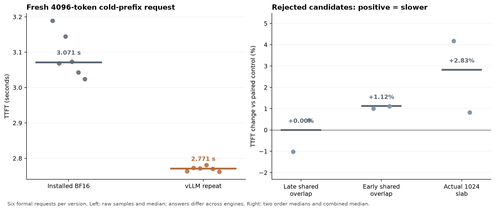

# Prefill 优化与 vLLM 重测：2026-10-12

> 后续 GDN 规范化 Q/K 缓存得到小幅 HTTP 收益并作为显式配置安装：两轮反向
> A/B 为 **3.071→3.035 秒（−1.19%）**，安装后独立确认快 1.62%，见
> [新报告](gdn-normalized-prefill-20261012.md)。下方是前一轮未安装候选与 vLLM
> 同轮重测的原始结果。

当前已安装 BF16 版本重新测得 4K HTTP TTFT **3071.08 ms**；本轮重新启动的
vLLM 为 **2770.79 ms**，原生仍慢 **300.29 ms / 10.84%**，输入/TTFT 吞吐低
**9.78%**。每版本六次请求，中位数均关闭 GPU profiling 和完整 logits 诊断。

本轮共享专家重叠和实际 1024 slab 未改善 HTTP TTFT；GDN warp 布局的算子
fixture 也未显示足够收益。没有替换已安装的运行时，也没有加入这些实验
profile 到正式入口。

## 已安装版本与 vLLM

| 指标 | 已安装原生 BF16 | 本轮 vLLM |
|---|---:|---:|
| 正式请求数 | 6 | 6 |
| 输入 token | 4096 | 4096 |
| TTFT 中位数 ms | 3071.08 | 2770.79 |
| TTFT 最小 / 最大 ms | 3023.76 / 3188.75 | 2761.80 / 2781.23 |
| 输出 token | 409，完整结束 | 512，上限结束 |
| 跨运行时回答一致 | 未要求 | 未要求 |

原生六次 TTFT：3188.75、3068.70、3144.53、3073.46、3043.18、3023.76 ms。
vLLM 六次：2763.16、2772.56、2771.45、2781.23、2770.13、2761.80 ms。
原生每次 409-token 回答相同，文本 SHA256 为
`9d24f298be3f0f3ebad6ceebefe1d7d8971854b4a489f0d0a30c5a994bca8cfc`。
vLLM 的六次文本 SHA 不同；不能用两者的 decode 或完整请求耗时声称同回答提速。

计时从 Z4 本机 HTTP 请求开始到首个非空 SSE content，包含 tokenizer、reset、
prefill 与首 token；它不是纯 GPU prefill kernel 时间。输入为冻结的真实文本
4096-token 请求，greedy、no-thinking、MTP4、单请求。各次模型启动之后，统一预热
一次短输入 / 8 输出、两次 4K / 8 输出；权重加载和 JIT 不计入 TTFT。

原生使用已安装 `build/native-bf16/q38-cuda-runtime`，SHA256
`ae51b96eb0e1122d069bfa7e8c4add722df5e024c2031a05b0620e7b00b8748e`，
`mtp4-native-bf16-candidate`、chunk 512、RAM PLE 64 GiB、原有 W4/W8 artifact。
vLLM 以隔离容器 `q38-vllm-prefill-20261012` 重放保留的配置：BF16、Marlin
linear/MoE、TP2/EP、PP1、MTP4、max sequences 8、batch tokens 8192；镜像 ID
`sha256:fae600eaa5b738ee42991d06c1c390a4dd0883a57925e6b3f1800ea8c615a385`。
保留其 12 CPU / 96 GiB 容器限制，原生没有同样的 CPU cgroup 限制。
模型与 overlay 为原有只读挂载，缓存、日志和 trace 使用本轮独立目录。
复现实录删除了 API key 和环境中的认证凭据。

每个原生正式请求均 prefix=0、suffix=4096、cold_rebuild=true、terminal reuse=false。
vLLM 每次使用新的 cache salt；metrics 的 prefix hits 和 external prefix hits 均为 0。
原生请求区间 major faults、swap、executor failure/rollback、Graph fallback、CUDA
allocation failure 均无增长；vLLM 每个请求前后 swap/oom vmstat 相同。
两种运行时顺序执行，ComfyUI、27B 和挖矿在全部正式请求期间都停止。
六次样本不能证明长期稳定性、并发性能或统计置信度；布局和分块不同也限制归因。

## 未保留的实验

### 共享专家与 routed 路径重叠

两种候选均为独立源码、二进制和显式 profile。shared expert 在辅助 stream
执行，routed 路径在主 stream 执行，输入事件和完成事件约束数据与缓存生命期。
decode / 小 MTP 路径不变，只对 eager TP prefill 启用。

| 六次 TTFT 中位数 | 同轮对照 ms | 候选 ms | 结论 |
|---|---:|---:|---|
| grouped Marlin 后启动 shared expert | 3102.712 | 3102.739 | 相差约 0.03 ms，无收益 |
| router/top-k 后启动 shared expert | 3068.986 | 3103.358 | 慢 1.12%，两种顺序均变慢 |

每个版本各六次，分两轮反向测试。后启动候选第一轮略快、第二轮更慢；合并
中位数几乎不变。前启动候选两个顺序均慢，未安装。

两个候选分别通过 9 组完整质量回答、5 个输入案例及 10 个拒绝位置；共 45 份
完整 248320-vocab BF16 logits、token 与续写全部逐位匹配旧 BF16 同路径参考。
raw cancel/deadline 三项、HTTP 取消/断开与恢复三项均通过。
输出一致性通过并不代表性能门禁通过。

### GDN recurrent 通信布局

测试了 warp-column shuffle、warp-column shared 和旧布局双 partial 缓冲。
保持四个 FP32 state cell、固定顺序的 32 行累加；完整状态/前缀在多种 token
长度、两 rank、eager/Graph 和 full/packed/control 输入下匹配旧布局。

前两种变体在 head-local fixture 中更慢；双 partial 缓冲只改善约 1.8–2%。
该 fixture 的 CUDA event 循环**包含状态 H2D reset**，不是纯 recurrent kernel
计时。没有据此声称整模型 TTFT 提速，变体均未安装。

## 实际 1024-token slab

此候选扩大编译期 `Q38_CUDA_PREFILL_SLAB_CAPACITY` 到 1024，使 workspace、
route-plan 容量和运行时上限一致，再使用 `--chunk 1024` 与
`Q38_CUDA_PREFILL_TILE=1024`。普通构建的默认容量仍为 512，十个旧 profile
的内容均不变。候选 profile 为 `mtp4-native-bf16-tile1024-candidate`。

超过 512 的 dense GEMM 按原有 512 行形状拆分，保留已验证的 cuBLAS 累加
算法；route grouping、GDN 和通信的实际 slab 扩大。此前仅提高入口 chunk
但内部仍被 512 截断的测试，不属于这个候选。

1024 正向 route-plan、无效 expert、两 rank owned/unowned 及 1025-token
超界拒绝检查通过。C++ 回归与 107 项 Python 检查通过。新二进制 SHA256：
`d5f795ddd55a334efcb4eeca9506e0ada7394169b0a75a580e44ece1466a1c8d`。
9 组完整回答、5 个输入案例及 10 个拒绝位置的 45 份完整 BF16 logits 与旧
BF16 同路径逐位一致；raw / HTTP 恢复各三项通过。

512 / 1024 的隔离 A/B 使用**同一个扩大容量的候选二进制**，仅切换入口 chunk
和内部 tile；这样避免把二进制/编译差异混入粒度对比。这些 512 对照不是上方
已安装原生版本的六次正式重测。两轮顺序为 512→1024、1024→512，各组三次
正式完整请求；预热与输出 SHA 门禁保持相同。

| TTFT 中位数 | 512 对照 ms | 1024 候选 ms | 候选变化 |
|---|---:|---:|---:|
| 第一轮：512→1024 | 3024.71 | 3151.00 | +4.18% |
| 第二轮：1024→512 | 3167.30 | 3193.36 | +0.82% |
| 合并，各六次 | 3092.90 | 3180.29 | +2.83% |

512 六次：3023.18、3024.71、3062.24、3167.30、3123.57、3212.32 ms。
1024 六次：3190.96、3063.68、3151.00、3193.36、3204.40、3169.61 ms。
十二次完整输出均为相同 409 token / 同一 SHA；cold prefix、fault/swap 和
failure/fallback 门禁全部通过。两个顺序均未改善，因此不安装。

另一次开启 globaltimer markers 的短输出请求，确认全部大 slab 为 1024，
position 为 0、1024、2048、3072；每个 GPU 两个 stage 共 8 条 slab 记录，
旧 512 profile 为 16 条。每 GPU 的 MoE Marlin/reduce 窗口次数 384→192，
GDN recurrent/collective 288→144，确实改变了实际执行粒度。

这一次诊断范围为 3052.84 ms，旧 512 诊断为 3227.09 ms；但两次诊断不是
同一候选二进制的反向 A/B，profiling 本身影响排队和 CPU 提交。即使局部窗口
和一次诊断总范围变小，正式 HTTP A/B 仍变慢，不能取诊断请求替代性能结果，
也不能将变慢确定归因为某一项 pipeline 等待。

## 耗时窗口与下一步依据

本轮另外采集了原生 globaltimer stream markers 和 vLLM CUDA-event scopes；
没有使用 CUPTI。性能表不使用这些开启诊断的请求。

| 观察窗口，物理 GPU0 | 原生 BF16 union ms | vLLM rank1 root union ms |
|---|---:|---:|
| 全部 marker 范围 | 3227.09 | 2719.55 |
| GDN recurrent + norm / fused packed core | 387.42 | 44.66 |
| grouped MoE Marlin / root `_C::marlin_gemm` | 473.25 | 108.92 |
| MoE routed reduce | 1430.45 | — |
| GDN collective | 1179.32 | — |
| root all-reduce | — | 2154.32 |
| QSA output / fused QSA with output | 561.33 | 66.27 |

原生在两张物理 GPU 上运行两个逻辑 stage，各 stage TP2；同一 GPU 的 stage
窗口会重叠，表内 union 也会互相重叠。范围包含 CPU 提交延迟、队列和等待，
不是纯 kernel、纯 PCIe DMA 或关键路径时间。vLLM scopes 有嵌套，表只取 root，
避免重复相加；两侧算子边界和算法不同，不能直接相减作为可节省时间。

原生每 GPU 记录到 288 个 GDN recurrent/norm 窗口与 384 个 MoE Marlin
窗口。vLLM 的 BF16 all-reduce 输入为 100 次 `[4088,2560]`、一次 `[8,2560]`。
共享专家重叠失败也说明，较大的局部耗时窗口不等于可回收的 HTTP TTFT。
后续继续关注提交/通信粒度和 GDN 的递推实现；并行 chunk GDN 会改变累加顺序，
需要另行通过数值门禁，不能直接当作兼容替换。

## 数值与运行限制

本轮对新候选使用的是**旧 BF16 同执行路径**作为完整 logits 参考。旧 FP24
和已安装 BF16 都存在 scalar / MTP 完整 logits 不逐位一致的已知问题，见
[BF16 报告](bf16-transport-20261012.md)。有限样本通过不能证明通用 token
等价、跨运行时输出一致或最终模型质量。

本轮复用此前完整验证的 354 segments / 212367104472 bytes 和 session
15997379919937726889：同一 boot，NAS artifact 保持只读且未修改。
新二进制单独完成质量和恢复门禁；本轮**没有重新完整哈希所有权重**。

初次 1024 CUDA fixture 的超界检查误把字节数 helper 当作验证入口；改成使用
真实 device storage 的 binder 后通过，首次失败日志保留。另一次在 CPU 回归
编译尚未完全退出时启动了候选加载，发现后立即终止加载，保留日志并改名隔离
该目录；没有执行质量测试。最终有效质量与性能测试前确认编译器和旧模型都已
退出。不能声称整个实验窗口从未出现编译/加载重叠。

外部 fsync 采集共 2097 次，全部保持 boot
`c354ceb6-2af6-4725-845f-aa7b20afc984`；没有捕获 Xid、OOM、AER/fatal 或 panic，
swap-in 为 0、swap-out 始终为此前的 164 页，最低 MemAvailable 167.41 GiB。
此前整机重启原因仍未解决，本轮无故障不能证明长期稳定性。

结束检查确认模型、sidecar、编译器和采集进程退出，没有 GPU compute app 或
运行中的容器。27B 与 `pearl-miner.service` 保持停止；NAS `/mnt/nas` 为只读，
每卡仍为 200W。没有重启服务、修改自动启动或安装候选，已安装 BF16 / FP24
回退二进制及正式源码均保持原 SHA。既有夜间定时器保留，下一次挖矿启动为
2026-10-13 00:30 上海时间，停止任务为 2026-10-12 08:30 上海时间。

## 证据

本地：`build/gdn-warp-prefill-20261012`；Z4：
`/home/icy/q38-gdn-warp-prefill-20261012`。目录日期记录实验起始日，报告记录
上海完成日；采集时间以 UTC / epoch ns 对齐。

- `summary.json`、`analyze-final.py`：正式 BF16 / vLLM 与前启动重叠审计。
- `overlap-first-summary.json`、`overlap-early-summary.json`：反向 A/B 原始样本。
- `qualification/formal-bf16`：已安装二进制命令、策略、stats、原始 SSE。
- `qualification/{overlap-full,overlap-early-full,tile1024-full}`：质量与恢复门禁。
- `vllm-reproduction.json`、`vllm-measured.json`、`vllm-results`、metrics 和 traces。
- `current-timeline-summary.json`、`vllm-timeline-summary.json`：不可相加的窗口分布。
- `tile1024-review.patch`、`tile1024-complete-source-audit.json`：完整六文件变更与旧 profile 审计。
- `tile1024-summary.json`、`analyze-tile1024.py`、`qualification/{current-tile1024-first,tile1024-first,tile1024-second,current-tile1024-second}`：1024 反向 A/B 与原始 SSE。
- `tile1024-timeline-summary.json`、`qualification/bf16-tile1024-timeline`：实际 1024 分块记录。
- `tile1024-fixture-first-failed.log`、`tile1024-fixture-final.log`、`tile1024-loading-aborted-build-overlap.log`：失败及修正记录。
- `incident/telemetry.jsonl`、`incident/kernel-live.log`：Mac 外部 fsync 采集。
- `incident/summary.json`、`final-state.json`：结束时的采集汇总、源码/二进制与服务状态。
